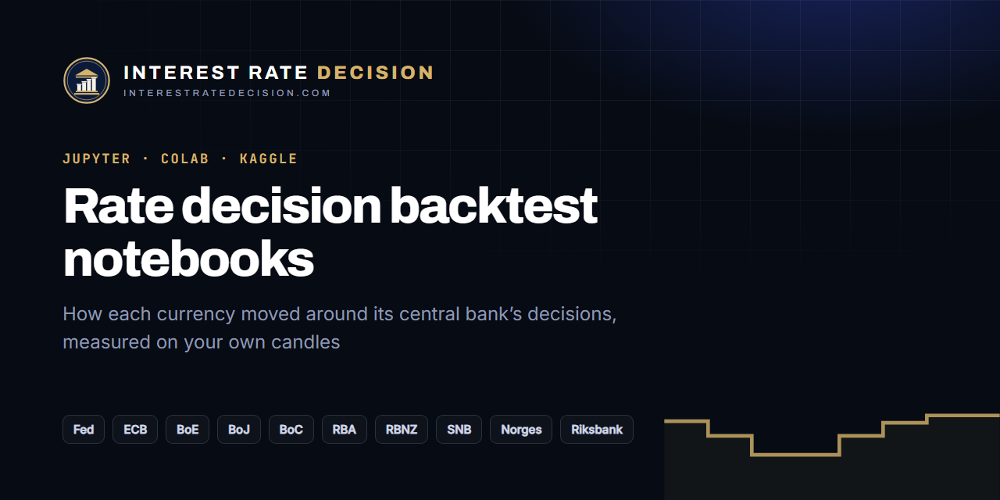

# Central bank decision backtest notebooks (Python)

[](https://interestratedecision.com/about/?via=notebooks)

[](https://github.com/Interest-Rate-Decision/notebooks/actions/workflows/ci.yml)
[](LICENSE)

Jupyter notebooks for studying how currency pairs react to central bank interest rate decisions: an FOMC backtest in Python, how EUR/USD reacts to the Fed and the ECB, GBP/USD to the Bank of England, and the same for the Bank of Japan, Bank of Canada, RBA, RBNZ, SNB, Norges Bank and Riksbank. Every decision since 2008 comes from [InterestRateDecision.com](https://interestratedecision.com/?via=notebooks)'s open data; the one-minute candles are yours, downloaded from Dukascopy with one command.

| Notebook | What it does | |
|---|---|---|
| [01-event-study](01-event-study.ipynb) | Each bank's decisions on its pair: the path from three hours before to five hours after, in pips, averaged by hike, hold and cut | [](https://colab.research.google.com/github/Interest-Rate-Decision/notebooks/blob/main/01-event-study.ipynb) |
| [02-surprise-vs-reaction](02-surprise-vs-reaction.ipynb) | The surprise (actual minus consensus) against the move 15 and 60 minutes after | [](https://colab.research.google.com/github/Interest-Rate-Decision/notebooks/blob/main/02-surprise-vs-reaction.ipynb) |
| [03-hour-before-range](03-hour-before-range.ipynb) | The hour before, the first spike through it, and how often it closes back: InterestRateDecision.com's own measurement | [](https://colab.research.google.com/github/Interest-Rate-Decision/notebooks/blob/main/03-hour-before-range.ipynb) |

They run end to end offline on a **synthetic sample** (the default, `SAMPLE = True`), so you can read the code working before downloading anything. The sample's figures mean nothing: its candles are a random walk.

## Run them

```sh
git clone https://github.com/Interest-Rate-Decision/notebooks.git
cd notebooks
pip install -r requirements.txt
jupyter lab
```

On Colab, use the badges: the first cell fetches this repository. On Kaggle, see [KAGGLE.md](KAGGLE.md).

## Get the candles

Dukascopy's candles are not ours to redistribute, so this repository ships none. Download your own, one of two ways:

**With the `dukascopy-node` CLI** (needs [Node.js](https://nodejs.org)): the helper reads the decisions and downloads the hours around each one, one CSV per decision, into `candles/<PAIR>/`.

```sh
python scripts/download_candles.py --banks fed ecb boe --since 2020-01-01
python scripts/download_candles.py --banks boj --since 2024-01-01 --dry-run   # print the commands only
```

Each decision is one call like `npx dukascopy-node -i eurusd -from 2026-10-28 -to 2026-10-29 -t m1 -f csv -p bid -dir candles/EURUSD -fn fed-2026-10-28`. Files already there are skipped, so run it again after new decisions.

**By hand**: export one-minute bid candles in GMT from Dukascopy's historical data page and save the CSVs in `candles/<PAIR>/`.

`ird_events.read_candle_csv` reads both formats (`timestamp,open,high,low,close` in epoch ms from the CLI; `Gmt time,Open,High,Low,Close,Volume` with `DD.MM.YYYY HH:MM:SS.mmm` from the website) and any CSV with a time column and open, high, low and close. Then set `SAMPLE = False` in the notebook's second cell.

| Bank | Pair | Bank | Pair |
|---|---|---|---|
| Fed | EUR/USD | RBA | AUD/USD |
| ECB | EUR/USD | RBNZ | NZD/USD |
| BoE | GBP/USD | SNB | USD/CHF |
| BoJ | USD/JPY | Norges Bank | EUR/NOK |
| BoC | USD/CAD | Riksbank | EUR/SEK |

These are the pairs InterestRateDecision.com measures each bank on. Paths are turned so that up means the bank's currency rose. Compare pips within one pair only: a pip on EUR/NOK is a tenth of the size of one on EUR/USD.

## The method

Notebook 03 is [InterestRateDecision.com's measurement](https://interestratedecision.com/about/?via=notebooks#method), rule for rule; `ird_events.reaction_of` gives the site's own figures on the site's own candles. The rules were set before any decision was counted:

- **The hour before**: the high and low of the 60 minutes before the announcement.
- **The first side**: the edge price trades through first, within 30 minutes.
- **The close back**: a five-minute candle, counted from the announcement, closing back inside the hour before within 60 minutes.
- **The other side**: after the close back, price trading through the opposite edge within four hours.

The decision brings a burst of orders; the first spike runs the stops beyond one side of the hour before (a stop hunt), and when it closes back the move often belongs to the other side. The counts include every decision where the first spike did not close back.

## The consensus is not in the open data

InterestRateDecision.com shows each decision's consensus on its page, from FXStreet's calendar, but that figure is not ours to redistribute, so `decisions.csv` has the decision, the rate and the change only. Notebook 02 takes your own `consensus.csv` (`bank,date,consensus`) when you have one; without it, it uses the move against the previous rate as a **proxy, which is not a surprise** (most moves are expected), and says so on every chart.

## Data and credit

- **Decisions**: [interestratedecision.com/data/decisions.csv](https://interestratedecision.com/data/decisions.csv) (bank, bank_name, time_utc, date, rate, change_bp), every decision of ten central banks since 2008. Free to reuse with a link to [InterestRateDecision.com](https://interestratedecision.com/?via=notebooks). `data/sample/decisions.csv` is a few rows of it.
- **Candles**: yours, from Dukascopy, under Dukascopy's terms. `data/sample/*_SYNTHETIC.csv` are generated by `scripts/make_sample.py` and are not prices.
- **The notebooks** are built from `scripts/build_notebooks.py` (edit there, then rebuild); CI checks they match and runs each on the sample.

## Read more

- [How often do central banks surprise?](https://interestratedecision.com/blog/how-often-do-central-banks-surprise/?via=notebooks) Every decision since 2008 against its consensus.
- [The most volatile forex news](https://interestratedecision.com/blog/most-volatile-forex-news/?via=notebooks): the banks ranked by the first 15 minutes.
- [How to trade FOMC](https://interestratedecision.com/blog/how-to-trade-fomc/?via=notebooks): the Fed's own record on EUR/USD.
- [Can central bank decisions be predicted?](https://interestratedecision.com/blog/can-central-bank-decisions-be-predicted/?via=notebooks)
- [The decision calendar](https://interestratedecision.com/calendar/?via=notebooks), with every result as it comes in.
- Learn to backtest and trade the news: [Forexia's courses](https://forexiapro.com/courses?via=notebooks).

Not financial advice. A past reaction says nothing certain about the next one.

## License

[MIT](LICENSE). The data keeps its own terms (above).

---

Part of the Forexia network: [InterestRateDecision.com](https://interestratedecision.com/?via=notebooks) · [Forexia Academy](https://forexiapro.com/courses?via=notebooks) · [TradingSignalBot](https://tradingsignalbot.com/?via=notebooks) · [PropSim](https://github.com/PropSim-Enterprise) · [OpenCharts](https://github.com/dylanpersonguy/OpenCharts)
